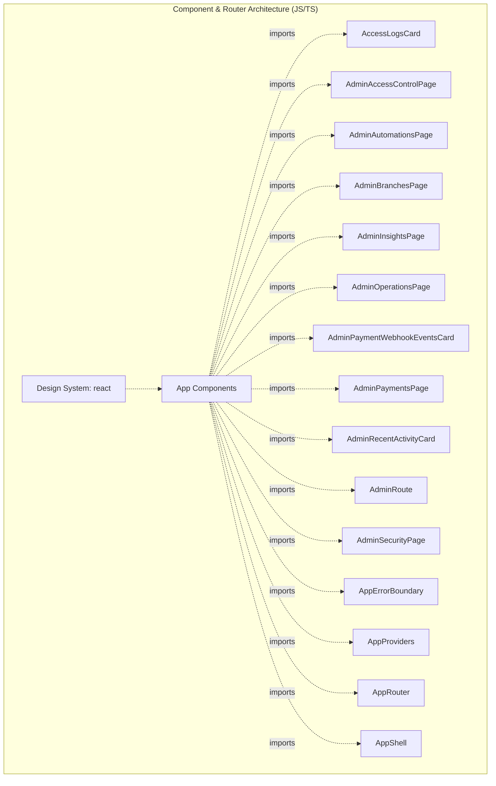

# Codebase Blueprint & Structural Graph

<!-- AUTO:BEGIN — regenerated by sync-architecture.sh. Do not edit. -->
## 1. High-Level Design (HLD) Topology


## 2. Current Target Directory Tree
```text
.
 Roadmap
  checkers-gym-management-app-roadmap
   checkers-gym-management-app
 docs
 gsclaude
 public
 src
  app
   auth
   config
  assets
   icons
   images
  components
   common
  context
  data
  features
   access
   accessibility
   account
   admin
   attendance
   auth
   automations
   billing
   blog
   bookings
   branches
   classes
   crm
   dashboard
   errors
   exercises
   finance
   insights
   marketing
   members
   notifications
   nutrition
   ops
   payments
   plans
   pos
   progress
   publicSite
   reports
   security
   staff
  lib
  services
  theme
  utils
 supabase
  functions
   admin-members
   cancel-payment-link
   create-payment-link
   issue-access-pass
   process-payment-retries
   process-refunds
   process-renewal-queue
   public-health-check
   razorpay-webhook
   run-daily-ops-summary
   run-renewal-reminders
   send-billing-email
   sync-payment-link
   verify-access-pass
  migrations
```
<!-- AUTO:END -->

## 3. Low-Level Design (LLD) & SOLID Class Schemas
- **Primary Interfaces:**
- **Cross-Service Communication:**
- **Data Inversion Maps:**

_Edit .project-architecture.manual.md; it is preserved across regenerations._
